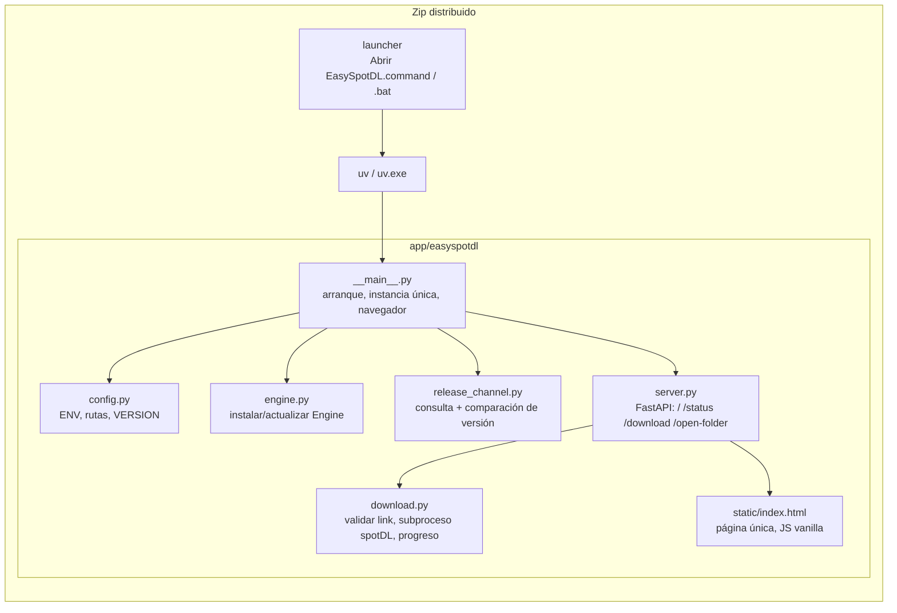
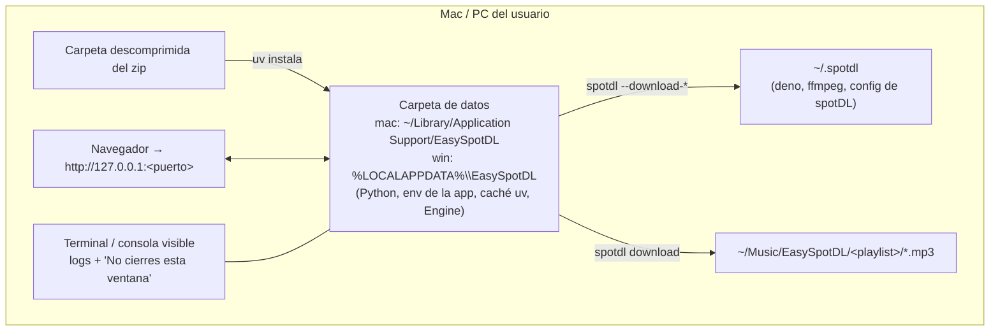
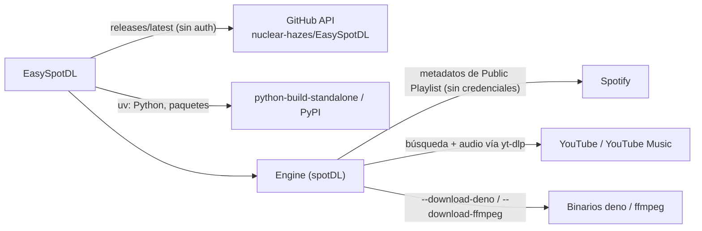
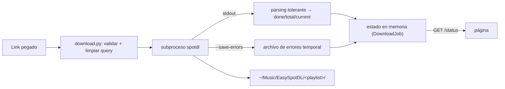

# Architecture: EasySpotDL

## Componentes

Nombres sugeridos de módulos en `app/easyspotdl/`.



## Topología en la máquina del usuario



## Sistemas externos



## Flujo de datos de una descarga



## Estructura del repositorio

```
launchers/        Abrir EasySpotDL.command, Abrir EasySpotDL.bat
app/              pyproject.toml, easyspotdl/ (módulos de arriba), tests/
scripts/build.sh  genera dist/EasySpotDL-{mac,win}.zip (descarga uv pinneado por plataforma)
docs/user/        LEEME.txt
VERSION           versión de EasySpotDL (semver)
```
