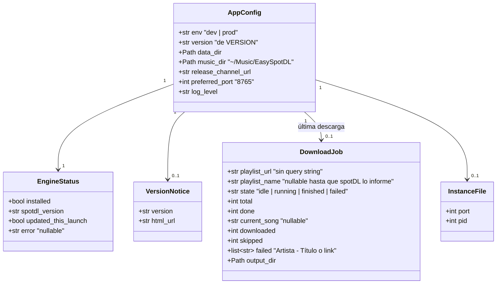

# Data Model: EasySpotDL

Sin base de datos. Todo el estado vive en memoria mientras la app corre, salvo el archivo de instancia (puerto) en la carpeta de datos. Los MP3 son la única salida persistente.



## Contrato `GET /status`

```json
{
  "app_version": "0.1.0",
  "engine": {"installed": true, "spotdl_version": "4.5.2"},
  "version_notice": {"version": "0.2.0", "html_url": "https://github.com/nuclear-hazes/EasySpotDL/releases/tag/v0.2.0"},
  "job": {
    "state": "running", "playlist_name": "Chill Mix", "total": 50, "done": 12,
    "current_song": "Coldplay - Yellow", "downloaded": 12, "skipped": 0, "failed": []
  }
}
```

`version_notice` y `job` pueden ser `null`.
