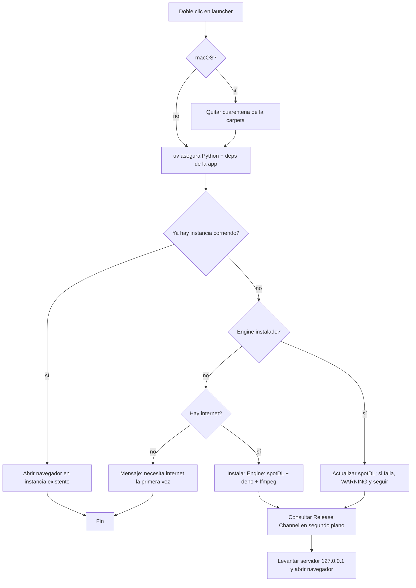
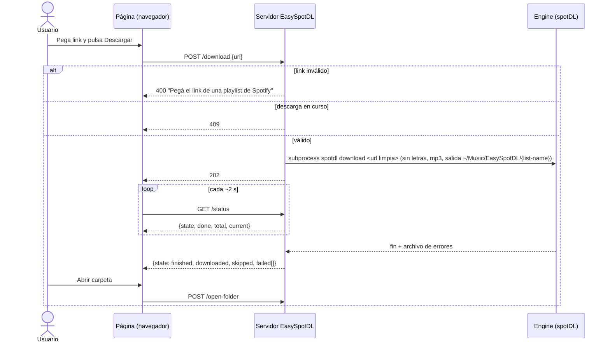
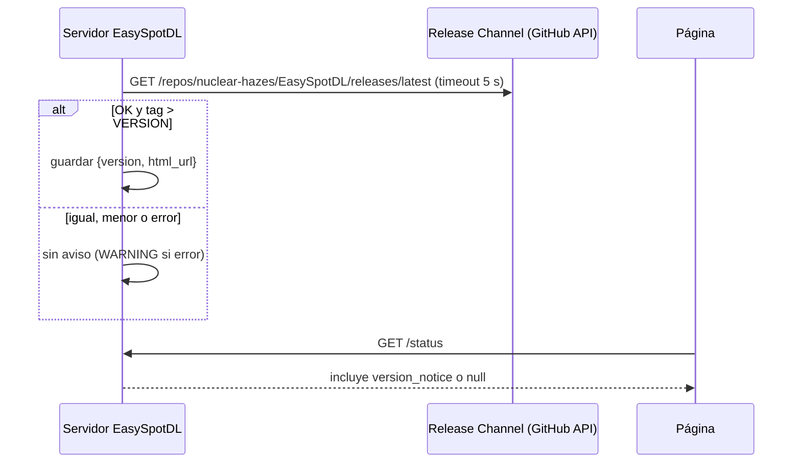

# Spec: EasySpotDL

Origin pitch: [I-0001](../../Pitches/I-0001.md)

# Problem

- Un grupo de nadadores no técnicos (4 hoy, más pronto) tiene audífonos que solo reproducen MP3. Pagan streaming, pero ningún servicio entrega MP3.
- spotDL convierte una Public Playlist en MP3 (vía YouTube), pero exige terminal, Python, ffmpeg y deno, y actualizarse seguido. Para estos usuarios la barrera es total.
- EasySpotDL elimina esa barrera: un zip, doble clic, pegar link, MP3 en una carpeta conocida.

# Context & Constraints

- **Appetite:** unas pocas horas, implementado con Claude Code. Ante cualquier desvío se recorta (Cut List), no se extiende.
- **Plataformas:** macOS Apple Silicon y Windows 11. Nada más.
- **Distribución:** zip portable publicado como GitHub Release en `nuclear-hazes/EasySpotDL`. Sin firma de código; se aceptan las advertencias de Gatekeeper / SmartScreen.
- **Engine:** spotDL 4.5.x (verificado en spike 2026-10-15). Hallazgos obligatorios (ver `MEMORY.md`): deno es requerido; la búsqueda de letras debe desactivarse; la interfaz web de spotDL no sirve (rechaza links de playlist).
- **Sin compilación:** el zip lleva el binario standalone de `uv`, que instala Python, las dependencias de EasySpotDL y el Engine en la carpeta de datos del usuario.
- **Spotify:** solo lectura de Public Playlist sin credenciales (modo por defecto de spotDL).

# Proposed Solution (High-Level)

Un launcher por plataforma ejecuta `uv`, que levanta una app Python con un servidor HTTP local y abre el navegador en una página única. La app prepara/actualiza el Engine, consulta el Release Channel y lanza spotDL como subproceso para cada descarga.

**Actor único:** Usuario (nadador no técnico). No hay administradores ni cuentas.

**Capabilities:**

- **cap-001 Launch** — Doble clic en el launcher (`Abrir EasySpotDL.command` / `Abrir EasySpotDL.bat`) → asegura Python y dependencias vía `uv`, levanta el servidor en `127.0.0.1` y abre el navegador. La ventana de terminal/consola queda visible con el texto "No cierres esta ventana". En macOS, el launcher quita el atributo de cuarentena de su carpeta.
- **cap-002 Engine Setup** — En el primer arranque instala el Engine (spotDL vía `uv tool`, más deno y ffmpeg vía los comandos de descarga de spotDL) en la carpeta de datos.
- **cap-003 Engine Update** — En cada arranque actualiza spotDL (con las versiones de dependencias que spotDL acepte). Sin internet: se saltea y sigue con el Engine instalado.
- **cap-004 Playlist Download** — El usuario pega un link de Public Playlist; la app valida que sea `open.spotify.com/playlist/<id>`, descarta parámetros de query y ejecuta spotDL con letras desactivadas, MP3 y salida en `~/Music/EasySpotDL/<nombre de la playlist>/`. Re-descargar la misma playlist usa el comportamiento por defecto de spotDL (saltea las existentes). Una descarga a la vez.
- **cap-005 Download Progress** — Durante la descarga muestra "N de M" y al final un resumen: descargadas, ya existentes, fallidas (con nombre de canción cuando esté disponible).
- **cap-006 Open Folder** — Botón "Abrir carpeta" que abre la carpeta de la última playlist en Finder / Explorador.
- **cap-007 Version Notice** — Al arrancar, consulta el Release Channel; si la versión publicada es mayor que la local, muestra el Version Notice con link a la página del release. Si falla la consulta, no muestra nada y la app funciona igual.
- **cap-008 Packaging** — Un script genera `dist/EasySpotDL-mac.zip` y `dist/EasySpotDL-win.zip` desde la Mac del autor, con launcher, binario de `uv` de cada plataforma, código de la app, `VERSION` y la guía. Sin ffmpeg, deno ni Python dentro.
- **cap-009 User Guide** — `LEEME.txt` en español: cómo abrir la app la primera vez (pasos de Gatekeeper y SmartScreen), dónde quedan los MP3 y qué hacer si algo falla.

# Acceptance Criteria

Los criterios marcados **[manual]** no se pueden automatizar (requieren GUI del sistema o Windows) y los ejecuta el autor o un tester humano.

### cap-001 Launch
- **launch_opens_browser:** ejecutar `Abrir EasySpotDL.command` en una Mac con la carpeta de datos ya preparada → en ≤ 30 s `GET http://127.0.0.1:<puerto>/` responde 200 con HTML que contiene "EasySpotDL", y la terminal muestra "No cierres esta ventana".
- **launch_port_fallback:** puerto 8765 ocupado por otro proceso → la app escucha en otro puerto libre y abre el navegador en ese puerto.
- **launch_already_running:** EasySpotDL ya corriendo, se ejecuta el launcher de nuevo → no se levanta un segundo servidor; se abre el navegador en la instancia existente.
- **launch_clears_quarantine [manual]:** zip descargado con navegador y descomprimido en Mac, se aprueba el launcher una vez en Configuración → Privacidad y seguridad → `xattr -lr <carpeta>` no muestra `com.apple.quarantine` y no aparecen más advertencias.

### cap-002 Engine Setup
- **engine_first_install:** carpeta de datos inexistente, con internet → al terminar el arranque `<datos>/tools` contiene spotDL y `spotdl --version` devuelve `4.x`; deno y ffmpeg están disponibles para spotDL; el log muestra INFO "Engine installed".
- **engine_first_run_offline:** carpeta de datos inexistente, sin red → la terminal muestra "EasySpotDL necesita internet la primera vez" y el proceso termina con código ≠ 0 sin traceback.

### cap-003 Engine Update
- **engine_update_upgrades:** Engine instalado con spotDL `4.5.0` → tras arrancar, `spotdl --version` devuelve la última versión publicada en PyPI.
- **engine_update_offline:** Engine instalado, sin red → la app abre normalmente y el log muestra WARNING "Engine update skipped".

### cap-004 Playlist Download
- **download_public_playlist:** pegar `https://open.spotify.com/playlist/37i9dQZF1EVHGWrwldPRtj?si=abc` y pulsar Descargar → en `~/Music/EasySpotDL/<nombre de la playlist>/` aparecen ≥ 90 % de las canciones de la playlist como `.mp3` con tags de título y artista.
- **download_no_lyrics:** durante `download_public_playlist` → el log de spotDL no contiene requests a `api.genius.com`.
- **redownload_skips_existing:** repetir `download_public_playlist` → 0 canciones nuevas descargadas, el resumen reporta las existentes como "ya existían", la carpeta no tiene archivos duplicados.
- **reject_track_url:** pegar `https://open.spotify.com/track/69kOkLUCkxIZYexIgSG8rq` → mensaje "Pegá el link de una playlist de Spotify" y no se lanza spotDL.
- **reject_garbage:** pegar `hola` → mismo mensaje, no se lanza spotDL.
- **single_download_at_a_time:** con una descarga en curso → el botón Descargar está deshabilitado y `POST /download` responde 409.

### cap-005 Download Progress
- **progress_updates:** durante `download_public_playlist` → la página muestra "N de M" con M = total de la playlist, y N aumenta al menos una vez cada 30 s mientras haya canciones pendientes.
- **summary_shown:** al terminar → la página muestra "Descargadas: X · Ya existían: Y · Fallaron: Z" con X+Y+Z = M, y una lista de Z entradas.

### cap-006 Open Folder
- **open_folder [manual]:** tras `download_public_playlist`, pulsar "Abrir carpeta" → se abre Finder (Mac) / Explorador (Windows) en `~/Music/EasySpotDL/<nombre de la playlist>/`.

### cap-007 Version Notice
- **notice_newer_version:** `VERSION` = `0.1.0`, Release Channel devuelve tag `v0.2.0` con `html_url` X → la página muestra "Hay una nueva versión de EasySpotDL (0.2.0)" con link a X.
- **notice_same_version:** `VERSION` = `0.1.0`, Release Channel devuelve `v0.1.0` → no se muestra Version Notice.
- **notice_channel_unreachable:** Release Channel inaccesible → no se muestra Version Notice, la app funciona, el log muestra WARNING.

### cap-008 Packaging
- **build_produces_zips:** ejecutar `scripts/build.sh` → existen `dist/EasySpotDL-mac.zip` y `dist/EasySpotDL-win.zip`.
- **zip_contents:** listar cada zip → contiene su launcher, el binario `uv` (`uv` para mac aarch64 / `uv.exe` para Windows x86_64), `app/`, `VERSION`, `LEEME.txt` y un `.env` con `ENV=prod`; no contiene `ffmpeg`, `deno` ni intérpretes de Python.
- **mac_launcher_executable:** descomprimir `EasySpotDL-mac.zip` → `Abrir EasySpotDL.command` y `uv` tienen permiso de ejecución.
- **windows_end_to_end [manual]:** en Windows 11, descomprimir `EasySpotDL-win.zip` y doble clic en `Abrir EasySpotDL.bat` (pasando SmartScreen) → el navegador abre la app y `download_public_playlist` se cumple con carpeta `%USERPROFILE%\Music\EasySpotDL\<nombre>`.

### cap-009 User Guide
- **guide_sections:** `LEEME.txt` → contiene las secciones "Mac", "Windows", "Dónde quedan los MP3" y "Si algo falla", en español.

# Key Flows

**flow-01 — Arranque.** Del doble clic al navegador abierto, incluyendo Engine y Version Notice.

**flow-02 — Descarga de una Public Playlist.**

**flow-03 — Version Notice.**

# Technical Considerations

- **Stack:** Python 3.12 gestionado por `uv` (binario standalone incluido en el zip). App: FastAPI + uvicorn, una página HTML con JavaScript vanilla que hace polling a `/status`. Se descarta Streamlit (pesado, control difícil de subprocesos y puertos).
- **Carpeta de datos:** macOS `~/Library/Application Support/EasySpotDL`; Windows `%LOCALAPPDATA%\EasySpotDL`. Ahí viven Python, el entorno de la app, el caché de `uv` y el Engine (variables `UV_*` apuntando a esa carpeta). deno y ffmpeg quedan donde spotDL los deja por defecto (`~/.spotdl`).
- **Engine:** `uv tool install spotdl` / `uv tool upgrade spotdl`; `spotdl --download-deno` y `spotdl --download-ffmpeg` si faltan. Invocación de descarga: `--lyrics` sin proveedores, `--format mp3`, `--output "{list-name}/{artists} - {title}.{output-ext}"` con cwd `~/Music/EasySpotDL`, `--save-errors <archivo temporal>`, `--simple-tui`.
- **Progreso:** se obtiene leyendo la salida del subproceso spotDL (total de la playlist y líneas por canción) y el archivo de errores al terminar. Parsing tolerante: si una línea no se reconoce, se ignora.
- **Release Channel:** API pública de GitHub sin autenticación (límite 60 req/h por IP, suficiente). Comparación semántica de `tag_name` sin la `v`.
- **ENV:** variable `ENV` (default `dev`, convención del proyecto). `dev`: log DEBUG y Release Channel leído de un archivo local de prueba (`DEV_RELEASE_CHANNEL_URL`, admite `file://`). `prod`: log WARNING y GitHub API (`PROD_RELEASE_CHANNEL_URL`). El zip incluye `.env` con `ENV=prod` y las URLs; no hay secretos.
- **Logging:** módulo `logging`, formato `YYYY-MM-DD HH:MM:SS [LEVEL] module: message`, a stdout (la ventana de terminal).
- **Validar primero (feasibility):**
  1. Que `xattr -dr com.apple.quarantine` desde el `.command` aprobado evita el bloqueo de Gatekeeper sobre `uv` y los binarios descargados.
  2. Que el `.bat` en Windows 11 con Mark-of-the-Web arranca `uv.exe` tras pasar SmartScreen, y que la consola muestra bien nombres con acentos (`chcp 65001`).

# Risks, Rabbit Holes & Open Questions

**Riesgos técnicos**
- YouTube rompe yt-dlp: mitigado por cap-003; no se fuerza yt-dlp por fuera de spotDL.
- Spotify endurece el modo sin credenciales: fuera de nuestro control; el error de spotDL se muestra tal cual en el resumen.
- Formato de salida de spotDL cambia entre versiones y rompe el parsing de progreso: el resumen final debe seguir funcionando aunque el progreso intermedio falle.
- Carpeta Música redirigida a OneDrive en Windows: se usa `%USERPROFILE%\Music` sin resolver redirecciones.

**Riesgos de producto/UX**
- La terminal visible puede confundir: el texto "No cierres esta ventana" y la guía lo mitigan.
- Advertencias de seguridad en el primer arranque: cap-009.

**Rabbit holes — NO ir ahí**
- No mejorar el matching de canciones, ni ofrecer calidad/bitrate/formato, ni letras.
- No construir un parser exhaustivo de la salida de spotDL: solo total, avance y fallas.
- No esconder la terminal en macOS ni crear un `.app` bundle.
- No resolver carpetas Música redirigidas ni rutas personalizadas.
- No implementar auto-actualización de EasySpotDL.
- No agregar CI/GitHub Actions: el build corre en la Mac del autor.

**Open questions**
- ¿Quién ejecuta los criterios [manual] de Windows 11? Bloquea marcar `[DONE]` el Scope 3, no el desarrollo.

# Scope: IN vs OUT

**IN**
- cap-001 a cap-009, macOS Apple Silicon y Windows 11, interfaz solo en español, solo Public Playlist.

**OUT (constraints)**
- NO aceptar links de canciones, álbumes, artistas, playlists privadas ni canciones guardadas.
- NO pedir ni guardar credenciales de Spotify, YouTube o GitHub.
- NO incluir ffmpeg, deno ni Python dentro del zip.
- NO firmar ni notarizar; NO publicar en tiendas.
- NO soportar macOS Intel, Windows 10 ni Linux.
- NO selector de carpeta de destino: siempre `~/Music/EasySpotDL/<playlist>/`.
- NO auto-reemplazar EasySpotDL; solo Version Notice con link.
- NO cargar archivos en dispositivos.

**Cut list** (en orden)
1. Lista de fallidas con nombres → solo el conteo de fallidas.
2. Progreso "N de M" en vivo → indicador "descargando…" + resumen final.
3. `launch_already_running` → aceptar un segundo servidor en otro puerto.
4. `launch_port_fallback` → puerto fijo con mensaje de error si está ocupado.
