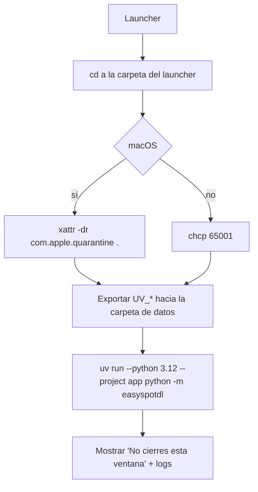
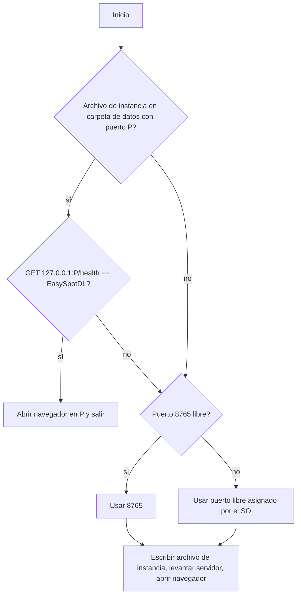
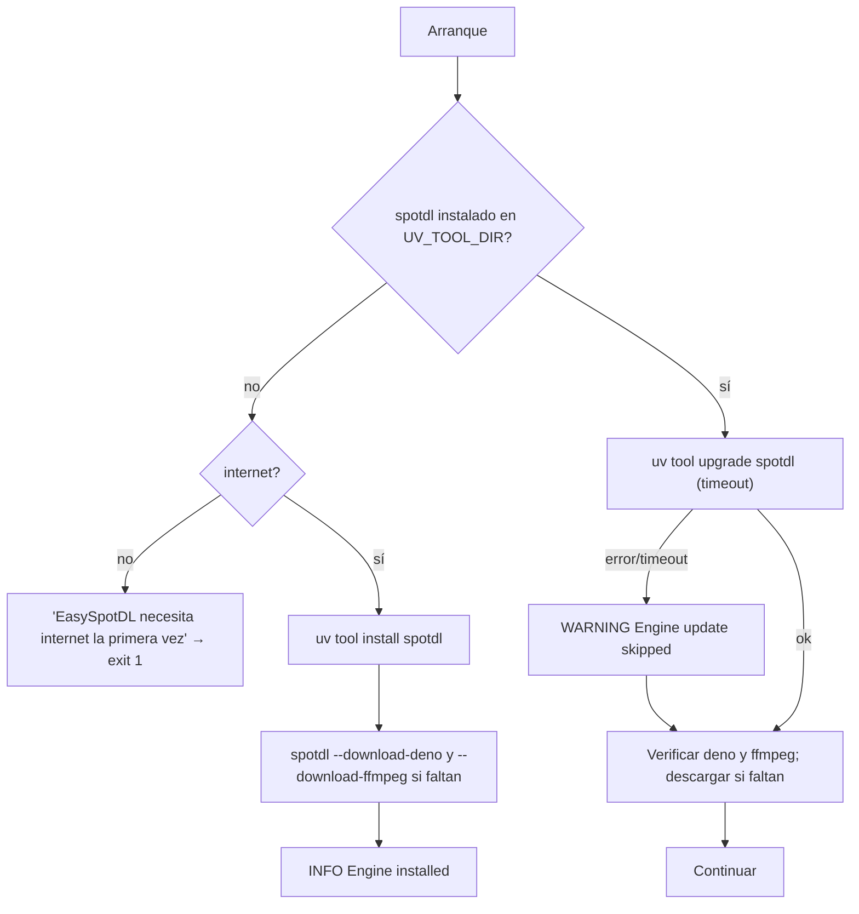
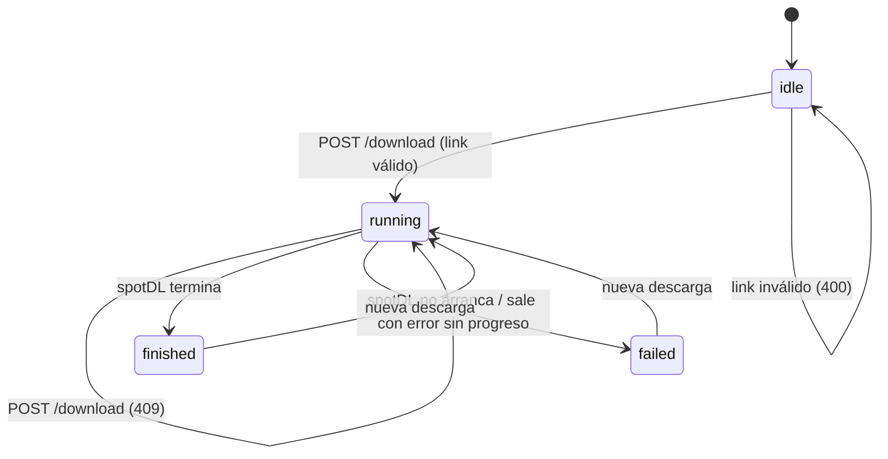
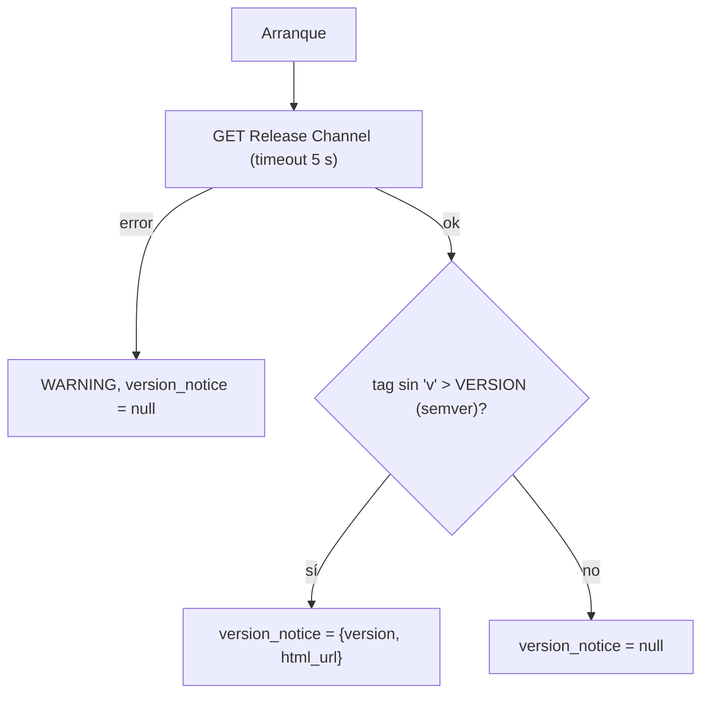
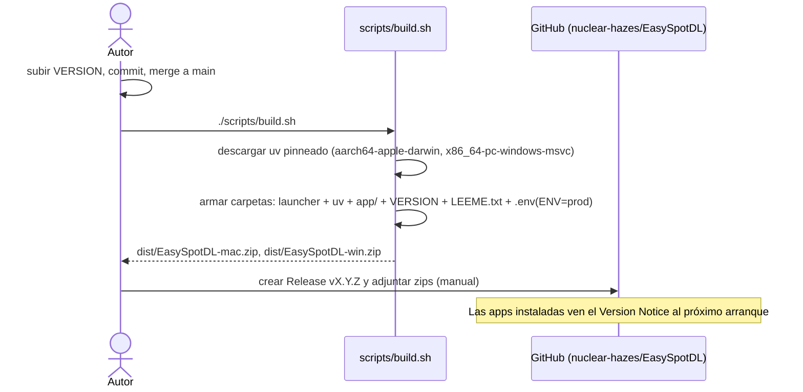

# Workflows: EasySpotDL

## Launcher por plataforma [cap-001, flow-01]

## Instancia única y puerto [cap-001]

## Engine Setup / Update [cap-002, cap-003]

## Estados de una descarga [cap-004, cap-005]

## Version Notice [cap-007, flow-03]

## Packaging y publicación [cap-008, cap-009]

